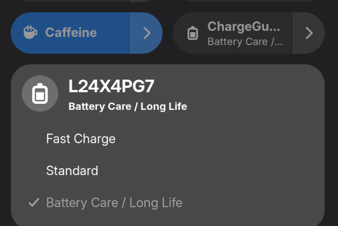
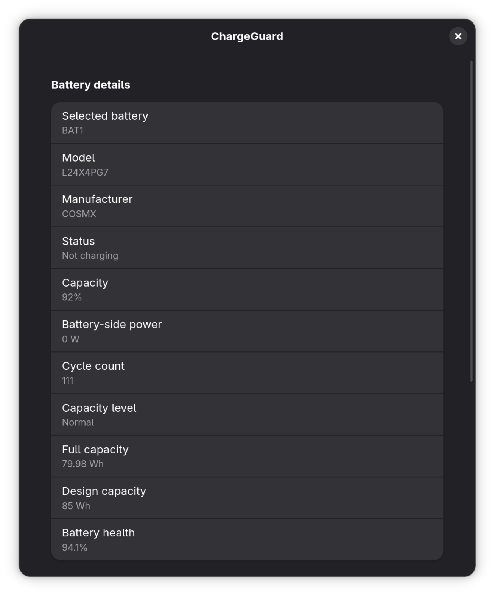

# ChargeGuard / 充电守护

[English](README.md) | 简体中文

直接在 GNOME Quick Settings（快速设置）中切换笔记本固件自带的充电模式，
还可以查看电池详情并使用 CLI 诊断；系统性能与通用电源调优仍交给专门的工具。

只有 Linux 内核能暴露 `Fast`、`Standard`、`Long_Life` 这类固件原生模式时，
ChargeGuard 才能发挥作用。是否支持取决于具体机型、固件和内核驱动，不能仅凭
厂商品牌判断。



## 你能获得什么

- 在 GNOME 快速设置中切换电池固件实际报告的模式。
- 在硬件提供数据时查看电池健康度、功率、身份信息和原生模式详情。
- 通过 CLI 先做只读检查，再进行本地诊断和受保护的模式切换。

ChargeGuard 是对 GNOME 电池指示器和电源模式的补充。它不会创建充电算法，
不会管理百分比阈值，也不会调整 CPU、磁盘、USB、Wi-Fi 等系统电源设置。

## 我的笔记本能用吗？

安装前可以先检查内核接口。下面的命令只读取 sysfs，不会改变充电模式：

```bash
for battery in /sys/class/power_supply/*; do
  [ -d "$battery" ] || continue
  [ -r "$battery/type" ] || continue
  [ "$(cat "$battery/type")" = "Battery" ] || continue
  echo "== $(basename "$battery") =="
  for attribute in charge_types charge_type \
    charge_control_start_threshold charge_control_end_threshold; do
    if [ -r "$battery/$attribute" ]; then
      printf '%s: ' "$attribute"
      cat "$battery/$attribute"
    fi
  done
done
```

请保守地解释结果：

| 检查结果 | ChargeGuard 的行为 |
| --- | --- |
| 有 `charge_types`（无论是否另有 `charge_type`） | 可以查看原生模式，并把固件报告的模式提供为切换选项；后续写入仍可能因固件、驱动或授权失败。 |
| 只有 `charge_type` | 可以看到当前模式，但 ChargeGuard 会将设备视为只读，因为无法校验安全的可选模式列表。 |
| 只有 `charge_control_*_threshold` 等控制项 | 这是百分比阈值充电，不属于 ChargeGuard 的范围。 |
| 上述文件都没有 | 当前机器不受支持，或当前固件/内核没有暴露对应接口。 |

准确边界见[兼容性说明](docs/compatibility.md)。不要因为同一厂商的其他机型可用，
就推断当前机型也受支持。

## 在 Arch Linux 上安装

需要 GNOME 桌面体验时，安装扩展包即可；它会自动依赖后端：

```bash
yay -S gnome-shell-extension-chargeguard
```

只使用 CLI 时：

```bash
yay -S chargeguard
```

扩展支持 GNOME Shell 50 和 51。安装或升级后，如果 GNOME Wayland 尚未加载
新扩展，请注销并重新登录，然后启用它：

```bash
gnome-extensions enable chargeguard@github.com
gnome-extensions info chargeguard@github.com
```

## 安全快速上手

先从只读检查开始。下面的命令不会改变充电模式：

```bash
chargeguard list
chargeguard current
chargeguard modes
chargeguard doctor
```

如果系统有多块电池，请传入 `list` 显示的设备，例如
`chargeguard current BAT1` 和 `chargeguard modes BAT1`。

在 GNOME 中打开快速设置并展开 ChargeGuard。菜单会显示当前模式和固件报告的
可选项；打开 **Details...** 可以查看电池和接口信息。



可选字段取决于硬件。缺失的健康度、循环次数、功率或身份属性会显示为不可用；
明确的采集失败则会保留在诊断结果中。

## ChargeGuard 与其他工具的区别

| 工具 | 主要用途 | 与充电模式的关系 |
| --- | --- | --- |
| ChargeGuard | 通过 GNOME 和 CLI 使用固件原生 `charge_type` / `charge_types` 模式 | 只使用电池报告的原始选项，不实现百分比阈值策略 |
| GNOME 电源模式 | 选择节能、均衡、性能等系统性能/能耗配置 | 属于另一类控制；ChargeGuard 不替代它 |
| TLP | 通用笔记本电源管理和电池养护配置 | 可在受支持硬件上管理部分电池功能；不要让两个工具写入同一个控制项 |
| 阈值工具 | 在驱动暴露阈值属性时设置充电开始/停止百分比 | 接口和策略都不同；ChargeGuard 不管理阈值 |

只要不管理同一个固件控制项，这些工具可以共存。TLP 和阈值工具的具体能力同样
取决于硬件和驱动。

## 进阶 CLI 用法

需要便于分享的结构化诊断快照时，可以运行：

```bash
chargeguard doctor --json
```

只有在 `modes` 已经显示目标电池准确的原始模式令牌后，才使用 `set`：

```bash
chargeguard modes BAT1
chargeguard set Long_Life --device BAT1
chargeguard current BAT1
```

`set` 是唯一会修改状态的命令。后端会根据电池当前报告的选项校验请求，通过原生
接口写入，再读取确认结果。固件报告了某个选项，并不保证固件或驱动一定接受后续
写入。

完整的命令、设备选择、诊断、错误和退出状态说明请运行 `man chargeguard`。

## 安全、隐私与限制

- 读取命令不需要模式切换的 polkit 授权；模式修改通过特权服务
  `chargeguardd` 和 polkit 完成。
- ChargeGuard 只写入所选电池当前报告的原始模式令牌，不写通用百分比阈值。
- ChargeGuard 没有遥测，也不会上传诊断信息。`doctor` 和 `raw` 输出可能包含
  设备标识、型号、sysfs 路径及驱动值，分享前请先检查。
- 硬件字段、模式名称、写入行为和支持情况可能随固件或内核更新而变化。多电池
  系统必须明确选择设备。

## 故障排查与深入阅读

- 没有模式切换入口，或结果显示不支持/只读：重新运行安装前检查，并阅读
  [兼容性说明](docs/compatibility.md)。
- 存在多块电池：把 `chargeguard list` 显示的设备 ID 传给 `current`、`modes`、
  `raw`，或通过 `set --device` 指定。
- 检查过程中读取失败：运行 `chargeguard doctor`，报告问题时保留其中明确的失败记录。
- 安装后看不到扩展：确认 GNOME Shell 50 或 51，在 Wayland 中注销并重新登录，
  再检查 `gnome-extensions info chargeguard@github.com`。
- 系统结构和权限边界：[架构说明](docs/architecture.md)。
- 问题反馈：[GitHub Issues](https://github.com/Ca11back/ChargeGuard/issues)。

维护和打包流程有意放在用户指南之外：
[发布操作手册](https://github.com/Ca11back/ChargeGuard/blob/main/docs/release.md)和
[Arch 打包说明](https://github.com/Ca11back/ChargeGuard/blob/main/packaging/arch/README.md)。
